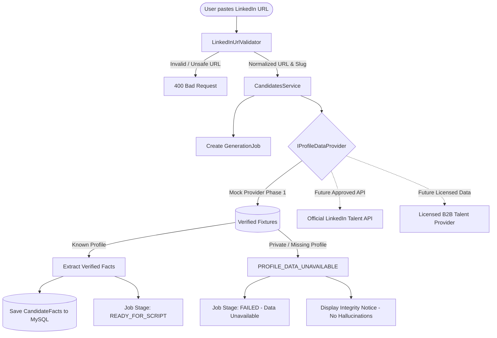
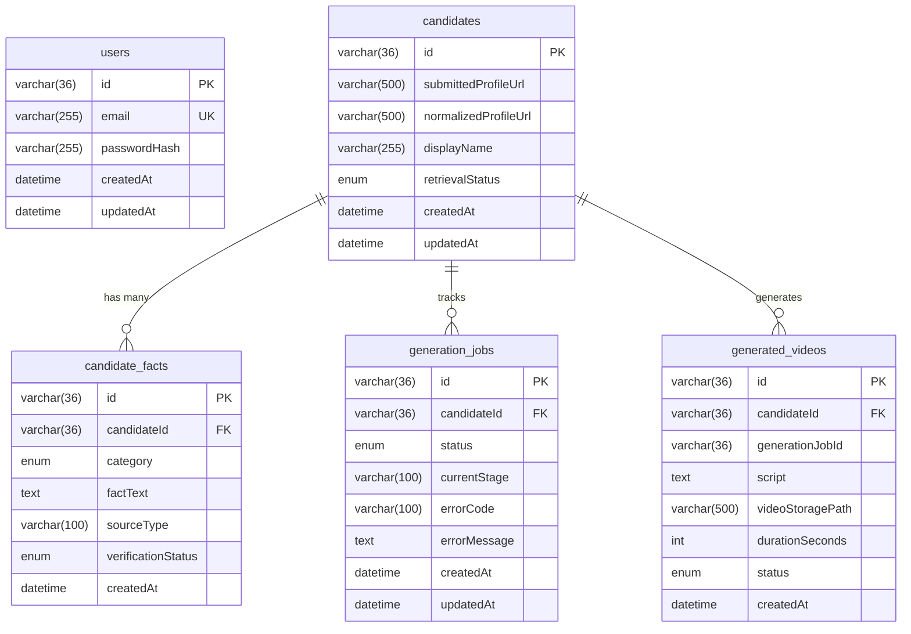

# ProfileReel AI – System Architecture Documentation

**Tagline:** "One profile. One AI. One powerful story."

---

## 1. Executive Summary & Vision

ProfileReel AI is a production-minded web application engineered to transform candidate LinkedIn profiles into short, narrated, animated video introductions. The core philosophy requires simplicity for the user:
- The **only mandatory input** is a candidate's LinkedIn profile URL.
- Résumé uploads or manual candidate-detail entry are never mandatory.
- **Zero Scraping & Zero Hallucination**: If profile data cannot be retrieved through authorized access, the system returns a structured `PROFILE_DATA_UNAVAILABLE` response with an explicit message. The AI will never fabricate career history, degrees, or achievements.

---

## 2. Monorepo Architecture

```
ProfileReel AI/
├── backend/
│   ├── src/
│   │   ├── config/            # Database and application environment configs
│   │   ├── database/          # TypeORM DataSource and versioned migrations
│   │   ├── modules/
│   │   │   ├── auth/          # User authentication and entities
│   │   │   ├── candidates/    # Candidate ingestion, persistence, and DTOs
│   │   │   ├── health/        # Real-time DB connectivity & system health checks
│   │   │   ├── jobs/          # Async job tracking and lifecycle stages
│   │   │   ├── profile-retrieval/ # Modular IProfileDataProvider & test fixtures
│   │   │   └── video-generation/  # Video entity and composition pipeline
│   │   ├── app.module.ts
│   │   └── main.ts            # Swagger OpenAPI, validation pipes, and bootstrap
│   ├── test/                  # Supertest e2e integration suites
│   ├── package.json
│   └── tsconfig.json
├── frontend/
│   ├── src/
│   │   ├── components/        # Navbar, SubmissionCard, DetailsCard, CandidateList
│   │   ├── pages/             # DashboardPage
│   │   ├── services/          # Typed API client
│   │   ├── types/             # TypeScript interfaces matching backend DTOs
│   │   ├── App.tsx
│   │   └── main.tsx
│   ├── package.json
│   ├── tailwind.config.js     # Dark charcoal / violet theme design system
│   └── vite.config.ts         # Vite bundler, proxy, and Vitest setup
├── docs/
│   ├── architecture.md        # This specification
│   └── phase1.md              # Phase 1 verification and operational summary
├── docker-compose.yml         # Containerized MySQL 8.4 service definition
├── .env.example               # Root configuration template
└── README.md                  # Comprehensive setup and run guide
```

---

## 3. Data Retrieval Feasibility & Compliance Analysis

Profile retrieval is the primary feasibility risk for any LinkedIn-based application. ProfileReel AI implements a modular abstraction layer to separate data retrieval from business logic.



### Constraints Adhered To:
1. **No Scraping**: No automated page scraping or HTML parsing of linkedin.com.
2. **No Session Hijacking**: No automation from logged-in sessions, cookie theft, or password storage.
3. **No CAPTCHA Bypassing**: Respect for network security and terms of service.
4. **Zero Hallucination Policy**: When data is unavailable, the pipeline stops gracefully. Missing facts are never invented by an LLM.

---

## 4. Normalized MySQL Database Schema

The backend directly connects to MySQL 8.4 using TypeORM with strict foreign keys, indexes, and versioned migrations.



---

## 5. Security & SSRF Protection

1. **LinkedIn URL Validation**: `LinkedInUrlValidator` checks protocol (`http`/`https` only), domain (must match `*.linkedin.com` or `linkedin.com`), path (`/in/{slug}`), and slug length (2–100 characters). All queries and tracking params are stripped.
2. **SSRF Guard**: Localhost, private IPs (10.x, 192.168.x, 127.x), metadata service IPs (169.254.169.254), and unsupported protocols (`ftp:`, `file:`, `javascript:`) are explicitly blocked.
3. **DTO Whitelisting**: NestJS `ValidationPipe` with `whitelist: true` and `forbidNonWhitelisted: true` strips unexpected payload properties.
4. **Credentials Isolation**: Zero hardcoded credentials. All configuration uses `.env`.
